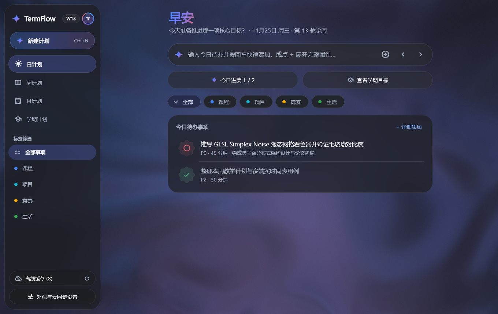
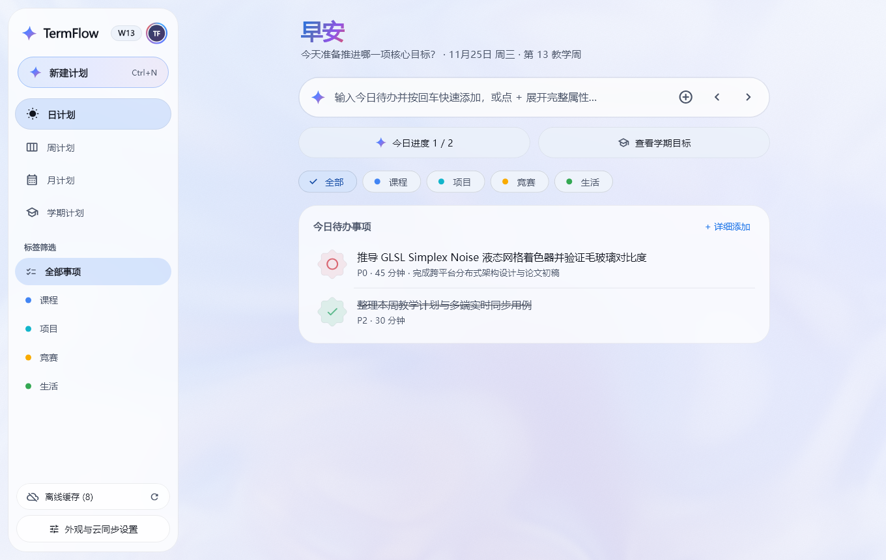
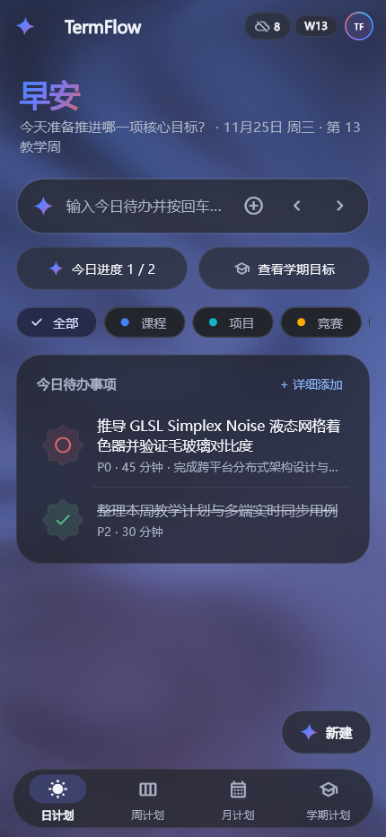

<div align="center">
  
  <h1>TermFlow</h1>
  <p><strong>Google Gemini App 美学风格 · 跨平台（Windows + Android）四级联动计划与时间管理软件</strong></p>
  <p>支持 <b>日 / 周 / 月 / 学期</b> 四级目标自动汇总进度 · 本地 SQLite 离线秒开 · Supabase 多设备实时云同步</p>
</div>

---

## ✨ 界面预览（v1.2.1 Gemini Fluid Edition）

| 桌面端 · Gemini 深色模式（主推） | 桌面端 · 浅色雾面模式 |
| :---: | :---: |
|  |  |

<div align="center">
  
</div>

---

## 🌟 核心特性

- **原生级 GLSL 液态极光动态背景**：内置硬件加速 `shaders/gemini_fluid.frag`（2D Simplex Noise + 双层 Domain Warping 流体变形 + 防色带胶片噪点），待机舒缓漂移，聚焦输入栏或云端同步时自动聚拢唤醒，并支持无障碍静态降级。
- **24px 毛玻璃透光设计语言**：基于解耦的 `GeminiTokens` 主题系统，支持深色/浅色一键切换，严格保障 **WCAG AA+/AAA** 正文对比度。
- **四级时间维度与自动进度联动**：
  - **学期计划（OKR）** → **月度里程碑** → **周核心目标 & 待办池** → **日计划清单**
  - 完成任一日待办时，自动沿 `parent_goal_id` 链条向上重算并推进周、月、学期目标百分比。
  - 支持**教学周自动计算**、**周待办一键分配到具体某日**、**昨日未完成任务一键顺延至今天**。
- **离线优先 + 多端实时双向同步**：
  - 本地采用 **Drift (SQLite)** 存储，断网秒开、全功能可用。
  - 云端支持自定义接入私人 **Supabase**（Last-Write-Wins 增量合并 + Realtime WebSocket 秒级推送）。

---

## 📥 直接下载安装

无需配置开发环境，可直接前往 [**GitHub Releases**](https://github.com/siunaus22/termflow/releases) 下载最新编译好的安装包：
- **Windows 电脑端**：下载 `TermFlow-Windows-x64.zip`，解压后双击 `termflow.exe` 即可运行（支持 `Ctrl+N` 全局新建）。
- **Android 手机端**：下载 `app-arm64-v8a-release.apk` 发送至手机安装（支持右滑完成、左滑顺延/删除）。

---

## ☁️ 多设备云同步与自定义域名配置教程

想要打通 Windows 与 Android 实时同步，或免费领取个人域名配置 Cloudflare 加速？请阅读完整图文级保姆教程：

👉 **[《从免费领取域名到打通多端实时云同步完整指南》](./docs/CLOUD_SYNC_AND_DOMAIN_GUIDE.md)**

---

## 🛠️ 本地开发与自行编译指南

### 1. 环境要求
- Flutter SDK `>= 3.24.0`
- Windows 桌面编译：Visual Studio 2022（勾选 *Desktop development with C++*）并开启系统「开发者模式」
- Android 编译：JDK 17 + Android SDK Platform 36

### 2. 拉取依赖与代码生成

```powershell
flutter pub get
dart run build_runner build
```

### 3. 运行与打包

```powershell
# Windows 桌面端运行 / 打包 .exe
flutter run -d windows
flutter build windows --release

# Android 端运行 / 打包 .apk
flutter run -d android
flutter build apk --release --split-per-abi
```

---

## 📄 开源协议

本项目基于 [MIT License](./LICENSE) 开源。
